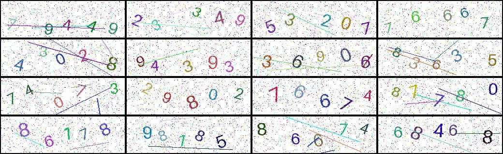

<style>
/* Print-specific styles to improve page breaks */
@media print {
  pre,
  .highlight,
  .codehilite {
    break-inside: auto !important;
    page-break-inside: auto !important;
    overflow: visible !important;
  }

  pre {
    white-space: pre-wrap;
    overflow-wrap: anywhere;
  }

  h2,
  h3,
  h4 {
    break-after: avoid-page;
    page-break-after: avoid;
  }
}
</style>

# CS172 Computer Vision I: CAPTCHA Recognition



CAPTCHAs distinguish human users from automated programs by asking them to recognize characters in noisy images. In this assignment, you will build a complete PyTorch pipeline for five-digit numeric CAPTCHAs: generate synthetic images, load and preprocess them, design and train a neural network, and evaluate its predictions. The goal is to understand how data quality, model design, and training choices affect recognition performance.

> [!CAUTION]
> This is an individual assignment. You may discuss ideas, but all submitted code and analysis must be your own.

## Learning Resources

Review these resources before starting if PyTorch or deep learning is new to you:

- [PyTorch: Learn the Basics](https://docs.pytorch.org/tutorials/beginner/basics/intro.html): tensors, datasets, models, automatic differentiation, and optimization
- [PyTorch: Datasets and DataLoaders](https://docs.pytorch.org/tutorials/beginner/basics/data_tutorial.html): custom datasets and minibatch loading
- [TorchVision documentation](https://docs.pytorch.org/vision/stable/): image I/O, model components, and computer-vision utilities
- [TorchVision transforms](https://docs.pytorch.org/vision/stable/transforms.html): preprocessing and data augmentation
- [Dive into Deep Learning](https://d2l.ai/): neural networks, optimization, convolutional networks, and ResNet

You do not need to read every page. Focus first on tensors, `Dataset`, `DataLoader`, `nn.Module`, loss functions, backpropagation, convolutional layers, and residual connections.

## Project Organization

A clear project layout keeps the implementation reusable, the notebook readable, and generated files separate from source code. We recommend the following organization:

```text
.
├── main.ipynb                 # experiment report, results, and analysis
├── README.md                  # setup and usage instructions
├── pyproject.toml             # project metadata and dependencies
├── .gitignore                 # generated and local files ignored by Git
├── src/cs172/                 # reusable Python package
│   ├── __init__.py
│   ├── generate_captcha.py    # CAPTCHA generation
│   ├── datasets.py            # data loading and preprocessing
│   ├── models.py              # neural-network components and models
├── scripts/                   # command-line entry points
│   ├── generate_data.py       # run the data-generation workflow
│   └── train.py               # run training and evaluation
├── data/                      # generated and provided datasets
└── outputs/                   # run configurations, metrics, and checkpoints
```

Use `main.ipynb` to present the experimental workflow and conclusions, not as the only location of your implementation. Keep reusable logic in `src/cs172/`; scripts should provide thin command-line interfaces that call this shared code. Store datasets in `data/` and experiment artifacts in `outputs/`.

Track source code, the notebook, documentation, and lightweight configuration files with Git. Because `data/` and `outputs/` can become large, normally exclude them through `.gitignore`. The filenames above are suggestions rather than strict requirements: you may adapt the layout if your project remains easy to run, understand, and reproduce. See [Engineering and Reproducibility Notes](#engineering-and-reproducibility-notes) for the rationale behind the `src/` layout and editable installation.

## Getting Started

### 1. Set up the environment

Use [Conda](https://anaconda.org/anaconda/conda) or [UV](https://github.com/astral-sh/uv) to manage your Python environments. Use Python 3.10 or later. We recommend using *pyproject.toml* to **manage dependencies and install your own package under the `src/` in editable mode.** This allows the notebook or scripts to import your package while reflecting later source changes without repeated installation.

The following is an example based on the recommended project organization:

```bash
conda create -n cs172 "python>=3.10"  # you may choose a different environment name
conda activate cs172
# Install your own package in editable mode along with its dependencies
pip install -e .
```

### 2. Generate data

Complete this part in two stages: first implement a function that creates one CAPTCHA, then write a script that generates and stores a complete dataset.

#### 2.1 Create one CAPTCHA

Refer to the sample test images in `data/test/` for the expected appearance. Your function should produce a five-digit numeric CAPTCHA with random digit colors, positions, and rotations, as well as interference lines and pixel noise. Use a font size sampled from the inclusive range **30–40 pixels**. The max number of interference lines is **5**, and the pixel noise ratio is **2%**. The final image should have a border of **2 pixels**.

The following signature shows some recommended parameters and default values:

```python
# generate_captcha.py
def generate_captcha(
    image_size=(260, 80),
    num_digits=5,
    font_size_range=(30, 40),
    ...,
    border_width=2,
    seed=None,
):
    # TODO: choose five random digits
    # TODO: draw them with random colors, positions, and rotations
    # TODO: add random interference lines and pixel noise
    # TODO: return the image and its label
    ...
```

Useful Pillow APIs include:

- `Image.new(...)` to create the background or a transparent image for one digit;
- `ImageDraw.Draw(image)` to obtain a drawing context;
- `ImageFont.truetype(...)` or `ImageFont.load_default(...)` to create a font;
- `ImageDraw.textbbox(...)` to calculate a digit's bounding box before positioning it;
- `ImageDraw.text(...)` to draw a digit;
- `Image.rotate(..., expand=True)` to rotate an individually rendered digit without clipping it;
- `Image.paste(...)` to compose rotated digits or apply pixel noise;
- `ImageDraw.line(...)` and `ImageDraw.rectangle(...)` to add interference lines and a border.

Keep every digit inside the canvas and preserve its left-to-right order. Use a local seeded random-number generator so the same seed recreates the same image.

#### 2.2 Generate a dataset

Write a generation script (e.g., `scripts/generate_data.py`) that repeatedly calls `generate_captcha`, and saves the images. Each filename must encode its label and a duplicate counter. For example, `12345#0.png` has the label `12345`. If another image has the same label, name it `12345#1.png`, then `12345#2.png`, and so on. The suffix prevents images with identical labels from overwriting one another.

Thousands of small image files require many file-system operations and can be slow to copy or access on shared storage. Writing the images directly into one ZIP archive is therefore preferred. If you use ZIP storage, design the later dataset class to read images directly from the archive instead of extracting a new copy for every run.

### 3. Load and preprocess data

**Complete a PyTorch `Dataset` that discovers samples, decodes each image as RGB, and extracts its five-digit label from the filename.**

Below is a skeleton and adapt it to your own design:

```python
# datasets.py
import os

import torch
from torch.utils.data import Dataset
from torchvision.transforms import v2 as transforms


class CAPTCHA(Dataset):
    def __init__(self, source, image_size, transform: transforms.Transform | None = None):
        self.source = os.fspath(source)
        self.image_size = image_size
        self.transform = transform
        # Recommend sorting image paths so that indexing is deterministic.
        self.img_paths = sorted(self._find_images())

    def _find_images(self):
        # TODO: list image paths in a deterministic order
        # For ZIP input, store archive member names instead
        ...

    def _read_image(self, img_path):
        # TODO: decode the selected file as an RGB image/tensor
        ...

    @staticmethod
    def _parse_label(filename):
        # "12345#0.png" -> tensor([1, 2, 3, 4, 5])
        stem = os.path.splitext(os.path.basename(filename))[0]
        digits = stem.split("#", maxsplit=1)[0]
        # TODO: validate the label and convert it to torch.long
        ...

    def __len__(self):
        return len(self.img_paths)

    def __getitem__(self, index):
        img_path = self.img_paths[index]
        image = self._read_image(img_path)
        label = self._parse_label(img_path)

        # TODO: apply optional torchvision.transforms.v2 transforms
        # TODO: return image [3, H, W] and label [5]
        return image, label
```

Check that `__getitem__` returns:

- an RGB image tensor with shape `[3, H, W]`;
- a `torch.long` label tensor with shape `[5]`.

Use [TorchVision transforms](https://docs.pytorch.org/vision/stable/transforms.html) to build the data transformation pipeline. Common operations include:

- `Resize` to produce a consistent spatial size;
- `ToDtype(torch.float32, scale=True)` to convert integer pixels to floating-point values in `[0, 1]`;
- `Normalize(mean, std)` to normalize each color channel;
- mild random transforms, such as `RandomAffine` or `ColorJitter`, for training-time augmentation (passed via the argument `transform`).

```python
from torchvision.transforms import v2

transform = v2.Compose([
    v2.Resize((height, width)),
    v2.ToDtype(torch.float32, scale=True),
    v2.Normalize(mean=channel_mean, std=channel_std),
])
```

> [!NOTE]
> Prefer `torchvision.transforms.v2` for new code. It provides the current transform API and works consistently with tensor images. See the [Transforms v2 documentation](https://docs.pytorch.org/vision/stable/transforms.html) for supported inputs and operations.

**A typical model usually receives resized, floating-point, normalized images, but these deterministic operations do not have to be implemented inside the dataset.** You may place them in the dataset transform, in a separate preprocessing function, or at the beginning of the model. Choose one location, apply it consistently during training and evaluation, and document the expected input range and shape. Avoid applying the same conversion or normalization twice.

Keep random augmentation outside the model and apply it only to the training dataset. Validation and test data should use deterministic preprocessing so that metrics are stable and comparable.

### 4. Build the model

**Create a PyTorch `nn.Module` that maps a batch of images to five-digit predictions.** The model should output logits with shape `[batch, num_classes, num_digits]`, where `num_classes` is 10 for the digits 0–9.

You can start with a standard ResNet from [`torchvision.models`](https://docs.pytorch.org/vision/stable/models/resnet.html). However, TorchVision ResNet ends with global average pooling and one fully connected layer. Replace its final layer so that it produces `num_digits * num_classes` logits, then reshape the output:

```python
# models.py
import torch
from torch import nn
from torchvision import models


class TorchvisionResNet(nn.Module):
    def __init__(self, num_digits=5, num_classes=10):
        super().__init__()
        self.num_digits = num_digits
        self.num_classes = num_classes

        self.backbone = models.resnet18(weights=None)
        in_features = self.backbone.fc.in_features
        self.backbone.fc = nn.Linear(
            in_features,
            num_classes * num_digits,
        )

    def forward(self, images):
        logits = self.backbone(images)
        return logits.reshape(
            images.shape[0], self.num_classes, self.num_digits
        )
```

For a batch of images, use the following convention throughout the project:

```text
input:  [batch, 3, height, width]
output: [batch, 10 classes, 5 digits]
target: [batch, 5 digits]
```

After the baseline works, implement your own ResNet variant. A CAPTCHA is ordered from left to right, but the global average-pooling layer in a standard ResNet collapses the spatial dimensions. Investigate whether preserving the final feature map improves recognition.

Your custom variant should:

1. implement a residual block with a main path and a skip connection;
2. use a projection on the skip path when the spatial size or channel count changes;
3. stack residual blocks into several stages;
4. discard global average pooling (`AvgPool2d` or `AdaptiveAvgPool2d`);
5. flatten the final feature map and map it to `num_digits * num_classes` logits;
6. reshape the logits to `[batch, num_classes, num_digits]`.

```python
# TODO: implement a residual block with two convolutional layers, batch normalization, and ReLU activation.
class BasicBlock(nn.Module):
    ...


class CAPTCHAResNet(nn.Module):
    def __init__(
        self,
        block=BasicBlock,
        layers=(2, 2, 2, 2),
        num_digits=5,
        num_classes=10,
    ):
        super().__init__()
        self.num_digits = num_digits
        self.num_classes = num_classes
        self.in_channels = 64

        # TODO: implement the ResNet stem:
        # convolution -> batch norm -> ReLU -> max pooling
        self.stem = ...

        self.layer1 = self._make_layer(block, 64, layers[0])
        self.layer2 = self._make_layer(block, 128, layers[1], stride=2)
        self.layer3 = self._make_layer(block, 256, layers[2], stride=2)
        self.layer4 = self._make_layer(block, 512, layers[3], stride=2)

        # TODO: create a classifier for the flattened spatial features.
        # Do not add global average pooling. The classifier must produce
        # num_digits * num_classes outputs.

        # TODO (optional): initialize convolution and normalization layers
        # following torchvision.models.resnet.ResNet.

    def _make_layer(self, block, channels, num_blocks, stride=1):
        out_channels = channels * block.expansion

        # TODO: create a projection shortcut when stride changes or when
        # self.in_channels does not equal out_channels.

        # TODO: make the first block use `stride` and the projection.
        self.in_channels = out_channels

        # TODO: append the remaining blocks with stride=1 and no projection.
        for _ in range(1, num_blocks):
            ...

        # TODO: return the stage as nn.Sequential(*blocks).
        ...

    def forward(self, images):
        # TODO: run the stem and four residual stages.
        # TODO: flatten all remaining spatial features.
        # TODO: compute and reshape the logits to
        # [batch, num_classes, num_digits].
        ...
```

For the classifier, `nn.LazyLinear` can infer the flattened feature size during the first forward pass, after which the spatial input size must remain consistent. Alternatively, calculate the feature size from the configured image dimensions and construct a regular `nn.Linear`. You may use max pooling or strided convolutions to control feature-map size. Verify the final output shape in `main.ipynb`. Compare the TorchVision baseline with your custom variant under otherwise similar training settings.

#### Where should the loss be implemented?

With logits shaped `[batch, num_classes, num_digits]` and targets shaped `[batch, num_digits]`, `torch.nn.functional.cross_entropy(logits, targets)` computes cross-entropy over the class dimension and averages across the batch and digit positions.

The loss may be implemented in either place:

- **`models.py`:** a `compute_loss` method can be convenient when a model has a specialized output structure or requires several model-specific loss terms.
- **`train.py`:** keeping the loss in the training pipeline separates the network architecture from the optimization objective and makes it easier to compare losses across models.

Both designs are acceptable. For this assignment, a small function in `train.py` might be suitable because all models use the same five-position classification objective. If the loss becomes model-specific, moving it beside the model is reasonable. Whichever design you choose, keep one authoritative implementation and use it consistently for training and validation.

### 5. Train the model

**Complete an epoch-based training pipeline.**

```python
# train.py
for epoch in range(num_epochs):
    # TODO: train with forward pass, loss, backpropagation, and update
    # TODO: evaluate on validation data without gradients
    # TODO: report loss, digit accuracy, and full-image accuracy
    # TODO: save the latest and best validation checkpoints
    ...
```

Follow these common experimental practices:

- **Fix random seeds.** Seed Python, NumPy, and PyTorch before generating data, splitting datasets, and initializing the model. Record the seed in the notebook. A fixed seed improves reproducibility, although exact results are not guaranteed across PyTorch versions, platforms, or CPU and GPU execution. See PyTorch's [Reproducibility notes](https://docs.pytorch.org/docs/stable/notes/randomness.html) for deterministic algorithms, CUDA behavior, and performance trade-offs.
- **Shuffle training data.** Set `shuffle=True` for the training `DataLoader` so that minibatches change between epochs. Use `shuffle=False` for validation and test loaders.
- **Monitor metrics.** At minimum, record loss, *per-digit accuracy*, and *full-image accuracy* for both training and validation after every epoch. Use validation full-image accuracy to select the best checkpoint.

---

Two accuracy metrics are:

- **Per-digit accuracy** is the fraction of individual digit positions predicted correctly across the dataset. For `N` five-digit images, its denominator is `5N`.
- **Full-image accuracy** is the fraction of CAPTCHA images for which **all five digits** are predicted correctly. An image counts as incorrect if even one position is wrong.

For example, if the target is `12345` and the prediction is `12305`, four of the five digits are correct. This sample contributes `4/5` to per-digit accuracy but `0` to full-image accuracy. Full-image accuracy is therefore stricter and better reflects whether a CAPTCHA has been solved successfully.

---

Your training function or script (e.g., `scripts/train.py`) should expose common experiment settings such as model choice, batch size, learning rate, weight decay, augmentation, seed, and checkpoint resumption. Choose a clear interface and document it in your own `README.md`.

### 6. Evaluate and analyze

Use `main.ipynb` to report the final test performance and the required analysis and ablation experiments. Present results with clear plots or tables, keep unrelated settings fixed in each comparison, and briefly explain your conclusions. See the rubric below for the required items and scoring.

## Rubric

Grading is based on the code, outputs, figures, tables, and analysis shown in the executed `main.ipynb`. The full credits are 100 points.

### 1. Data generation — 5 points

- Demonstrate that the generator produces valid five-digit CAPTCHA images.
- Show representative samples with random colors, positions, rotations, interference lines, and pixel noise.

### 2. Dataset and preprocessing — 5 points

- Demonstrate that the custom `Dataset` loads images and parses labels correctly.
- Show one or more batches from the `DataLoader` and verify image shapes, label shapes, and data types.
- Demonstrate the training/validation split and the required preprocessing.

### 3. Model — 5 points

- Demonstrate that one implemented model accepts a batch and returns logits with the expected shape.
- Briefly summarize the architecture and report its number of parameters.

### 4. Training report — 5 points

- Plot training and validation loss, per-digit accuracy, and full-image accuracy over epochs.
- State the configuration used for the final model, including the seed, model, training-set size, optimizer, batch size, learning rate, regularization, augmentation, and number of epochs.

### 5. Evaluation — 40 points

Evaluate the selected model on the required test data (5 test sets under `data/test/`, totally 500 images) and report both accuracies. The score is calculated as:

```text
evaluation score = 20 × max(per-digit accuracy - 0.95, 0) / 0.05 + 20 × max(full-image accuracy - 0.9, 0) / 0.1
```

### 6. Analysis and ablations — 40 points

Each item is worth 5 points. For every experiment, keep unrelated settings fixed and select checkpoints using validation full-image accuracy. Curves over training epochs should show validation metrics; final performance comparisons should report aggregate test results directly. Present each result with a clear, simple plot or table and state a concise conclusion.

1. **Training-set size:** evaluate at least three different training-set sizes and plot aggregate test performance against the number of training images.
2. **Data augmentation and overfitting:** compare training with and without data augmentation. Plot validation metrics over epochs, compare aggregate test results, and explain the effect on overfitting.
3. **Regularization and overfitting:** compare multiple weight-decay values. Plot validation metrics over epochs, compare aggregate test results, and explain the effect on overfitting.
4. **Batch size:** compare multiple batch sizes using validation curves, aggregate test results, and consistently measured training time. Discuss convergence, accuracy, and speed.
5. **Learning rate:** compare multiple learning rates using validation curves and aggregate test results. Discuss convergence speed, stability, and test performance.
6. **Backbone comparison:** compare at least two models, such as ResNet-18 and ResNet-34, under comparable settings. Report validation curves and aggregate test results.
7. **Global average pooling:** compare models with and without global average pooling under comparable settings. Report validation curves and aggregate test results, and analyze whether preserving spatial information helps CAPTCHA recognition.
8. **Prediction visualization:** show predictions alongside ground-truth labels. If full-image accuracy is below 100%, failure cases **must** be included and analyzed.

## Submission

Submit:

1. A PDF export of the completed `main.ipynb`.
2. `ChineseName-StudentID.zip`, containing the complete project **without `data/`**.

## Engineering and Reproducibility Notes

These practices are not required for a minimal solution, but they make the project easier to maintain, reproduce, and evaluate.

### Separate reusable code from entry points

A small prototype can place every Python file beside the notebook. This flat layout is easy to start, but responsibilities and imports become unclear as the project grows. The [Python Packaging User Guide's comparison of the `src` and flat layouts](https://packaging.python.org/en/latest/discussions/src-layout-vs-flat-layout/) explains their import and installation behavior. The recommended layout separates reusable code from executable workflows:

- `src/cs172/` contains the importable package: datasets, models, metrics, and other reusable functions.
- `scripts/` contains entry points. Each script should parse arguments and call package functions rather than duplicate their implementation.

For example, both `scripts/train.py` and `main.ipynb` can import the same dataset and model from `cs172`. This ensures that notebook results and command-line experiments use identical code. Include `src/cs172/__init__.py` to make the package boundary explicit; see the [Python tutorial on packages](https://docs.python.org/3/tutorial/modules.html#packages).

### Why use `pyproject.toml`?

[`pyproject.toml`](https://packaging.python.org/en/latest/specifications/pyproject-toml/) is the modern, standardized configuration file for Python projects. For this assignment, it replaces project metadata and packaging configuration that older projects commonly placed in `setup.py` or `setup.cfg`. Its `[project]` table declares information such as the package name, version, supported Python version, and direct runtime dependencies. It can also contain build-system and tool-specific configuration.

Using `pyproject.toml` is good practice because it is declarative and tool-independent: packaging tools can read project metadata without executing arbitrary setup code, and configuration can be kept in one documented format. It also supports isolated builds and works with modern build backends such as setuptools, Hatchling, and Flit.

Running `pip install -e .` reads the project configuration, installs its dependencies, and installs the local package in **editable mode**, so source changes are immediately available to scripts and notebooks. See pip's guide to [local and editable project installs](https://pip.pypa.io/en/stable/topics/local-project-installs/) for details.

`requirements.txt` has a different role; `pyproject.toml` does not directly replace it. A requirements file lists packages to install for a particular environment and may pin exact versions for reproducibility. In contrast, `pyproject.toml` defines the project and its direct dependency constraints. A project may use both, but this assignment uses `pyproject.toml` as the authoritative project configuration.

### Why Python 3.10 or later?

The project uses modern built-in type-annotation syntax. Python 3.9 introduced parameterized built-in collections such as `list[str]` and `tuple[int, int]`; Python 3.10 added the `|` union operator used in annotations such as `str | None`. These forms are shorter and easier to read than older equivalents such as `List[str]` and `Optional[str]` from `typing`. See the [Python 3.10 `typing` documentation](https://docs.python.org/3.10/library/typing.html) for the complete syntax and semantics. Type annotations improve readability and static analysis, but Python does not enforce them automatically at runtime.

### Keep configuration and results together

Create a separate output directory for every experiment. Save the seed, dataset description, model configuration, hyperparameters, metrics, and checkpoints together. This prevents accidental overwrites and makes every table or plot in `main.ipynb` traceable to a specific run. PyTorch's [reproducibility notes](https://docs.pytorch.org/docs/stable/notes/randomness.html) explain seed control, deterministic operations, and their limitations.

```text
outputs/<experiment-name>/
├── config.json
├── metrics.json or metrics.csv
├── best.pt
└── latest.pt
```

### Make checkpoints resumable

A weights-only checkpoint is sufficient for inference. To resume training faithfully, also save the current epoch, optimizer state, learning-rate scheduler state, and best validation score. Use `map_location` when loading so a checkpoint can be opened on a different device. Refer to PyTorch's [Saving and Loading Models](https://docs.pytorch.org/tutorials/beginner/saving_loading_models.html) tutorial for inference checkpoints, resumable checkpoints, and cross-device loading.

Select the best checkpoint using validation performance, not test performance. Evaluate the selected model on the test set only after model and hyperparameter choices are complete.
